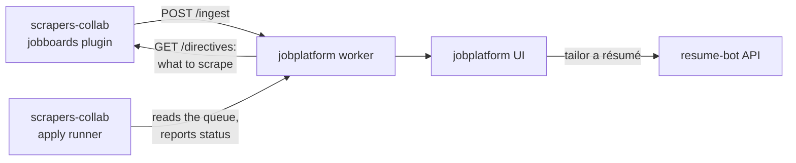

# Onboarding: the job-search pipeline

For a new contributor setting up the job-search pipeline on their own computer.
The pipeline spans three repos, and this page sets up all three in order. The
credential steps are a copy of
[hadoku.me/docs/contributing](https://hadoku.me/docs/contributing/), which
every hadoku repo shares. If the two disagree, that page is right; tell the
owner so this one gets fixed.

## The three repos

| Repo                                                                       | Visibility | What it is                                                                              | Credential                                                      |
| -------------------------------------------------------------------------- | ---------- | --------------------------------------------------------------------------------------- | --------------------------------------------------------------- |
| [hadoku-jobplatform](https://github.com/WolffM/hadoku-jobplatform)         | public     | The feed, triage and application UI (React) and its API (Cloudflare Worker, TypeScript) | `jobplatform-service-key`, for `pnpm dev` and `pnpm test:e2e`   |
| [hadoku-resume-bot](https://github.com/WolffM/hadoku-resume-bot)           | public     | The tailored résumé and cover-letter API, and the résumé chat widget                    | `resume-bot-service-key`, for installing and friend-only routes |
| [hadoku-scrapers-collab](https://github.com/WolffM/hadoku-scrapers-collab) | private    | The job-board scrapers and the apply runner, as Python plugins for the scrape service   | none                                                            |



## 1. What the owner sets up

Ask the owner to confirm each of these before you start:

- [ ] A hadoku.me account at **friend** tier or above, and the key to sign in with.
- [ ] Service grants for **`jobplatform-service-key`** and **`resume-bot-service-key`**.
- [ ] A GitHub invite to **hadoku-scrapers-collab**, which is private. Accept it from
      your GitHub notifications or email: an invite expires after 7 days.
- [ ] Write access to the two public repos, if you will push branches there instead
      of working from a fork.

## 2. Your computer, once

- Node 22 or newer, git, and pnpm 11 (`corepack enable` sets pnpm up).
- Python 3.11 or newer, for scrapers-collab.
- A user `.npmrc` (`~/.npmrc`, or `C:\Users\<you>\.npmrc` on Windows; create it if
  it is missing) with these two lines, exactly as written:

  ```ini
  @wolffm:registry=https://npm.pkg.github.com
  //npm.pkg.github.com/:_authToken=${NODE_AUTH_TOKEN}
  ```

  Leave `${NODE_AUTH_TOKEN}` as it is: dev-vault fills it in for each command it
  runs. resume-bot's install needs this. jobplatform's does not.

## 3. Your credential: once per clone, then every 7 days

There are no shared keys. You hold your own credential for each repo. It lasts 7
days, and you renew it with your passkey and an authenticator app.

1. Sign in at [hadoku.me](https://hadoku.me), in the browser you will approve from.
2. In the clone, run `npx @hadoku/dev-vault login`. It prints a code and a link to
   hadoku.me/account/device. Leave it running: it waits up to 24 hours.
3. Open the link. It shows which machine and repo are asking. **The first time only:**
   - save a passkey (Windows Hello, Touch ID or your phone) if you have none;
   - set up your authenticator: tap the passkey, scan the QR code with an
     authenticator app, then type its 6-digit code.
4. **Every time:** check the identity (it picks the repo's for you), type the app's
   current code, press **Approve** and tap your passkey.
5. The terminal says it wrote `.devvault.local.json` in your clone. That file is
   gitignored. Never commit it or share it.
6. Check it with `npx @hadoku/dev-vault --check`.

Renew with `npx @hadoku/dev-vault login` every 7 days, or whenever hadoku.me answers
401 or `required: friend`. After the first time it is just the approve screen.

## 4. Set up each repo

### hadoku-jobplatform

```sh
git clone https://github.com/WolffM/hadoku-jobplatform.git
cd hadoku-jobplatform
pnpm install                          # needs no credential
npx @hadoku/dev-vault login           # step 3, identity jobplatform-service-key
pnpm exec playwright install chromium # once, for the browser tests
pnpm dev                              # http://localhost:5173
```

The dev server talks to the **real production API**. To sign in, open
`http://localhost:5173/?apiKey=<your hadoku.me key>` once. It swaps the key for a
session cookie the way production does. After that, plain `localhost:5173` keeps
you signed in.

The checks CI runs need no credential:

```sh
pnpm lint
pnpm lint:css
pnpm typecheck
pnpm test:unit
pnpm test:extension
cd worker && pnpm test
```

`pnpm test:e2e` runs the browser suite against the real API, signed in as the shared
e2e test account.

### hadoku-resume-bot

```sh
git clone https://github.com/WolffM/hadoku-resume-bot.git
cd hadoku-resume-bot
npx @hadoku/dev-vault login            # step 3, identity resume-bot-service-key
npx @hadoku/dev-vault -- pnpm install  # its packages come from GitHub Packages
pnpm dev                               # http://localhost:5173
```

Stop the jobplatform dev server first: both use port 5173. The rest of its commands
are in that repo's `docs/guide/contributing.md`.

### hadoku-scrapers-collab

No credential: setup, the unit tests and ruff need only PyPI.

```sh
git clone git@github.com:WolffM/hadoku-scrapers-collab.git
cd hadoku-scrapers-collab
python -m venv .venv
.venv/bin/pip install -e '.[dev]'
.venv/bin/python -m patchright install --only-shell chromium
.venv/bin/python -m pytest tests/unit/ -q
.venv/bin/python -m ruff check .
```

On Windows, `.venv/bin/` is `.venv\Scripts\`. Its `AGENTS.md` has the plugin
contract and the rules the scrape service enforces.

## 5. Check that it all works

- [ ] `npx @hadoku/dev-vault --check` passes in the jobplatform and resume-bot clones.
- [ ] jobplatform: `pnpm dev`, sign in with `?apiKey=`, and the feed shows your profiles.
- [ ] jobplatform: `cd worker && pnpm test` passes.
- [ ] resume-bot: `pnpm dev` renders the résumé.
- [ ] scrapers-collab: pytest and ruff both pass.

## 6. Before your first change

- **Read the repo's `AGENTS.md` first.** It holds the rules each change must keep,
  and why. jobplatform's also has the full route table. Its
  [`docs/guide/contributing.md`](guide/contributing.md) is the architecture map.
- **The dev server changes real data.** What you save in `pnpm dev` is saved for your
  real account.
- **Never press "Queue for Auto-Apply"** in dev or in a test. It queues a real
  application, which the apply runner fills in and can send to a real employer. A
  browser test must block the route: `page.route('**/jobs/*/apply', r => r.abort())`.
- **Colours come from theme tokens** (`var(--color-*)`), never hex values or
  fallbacks. `pnpm lint:css` checks this.
- **CI sets version numbers.** Never edit one by hand.
- **No `.env` files.** Secrets come only through dev-vault.
- **Merging to `main` ships to production.** jobplatform publishes and the site
  redeploys within minutes. scrapers-collab deploys to the scrape service within
  about ten. Open a pull request unless the owner has agreed otherwise.
- **To see what happened in production,** query telemetry with your own credential.
  jobplatform's `AGENTS.md`, section "Telemetry", has the commands and every event
  name.

## If something goes wrong

| What you see                                     | What to do                                                                                                   |
| ------------------------------------------------ | ------------------------------------------------------------------------------------------------------------ |
| "You hold no service grants" on the approve page | The grant for that identity is missing. Ask the owner.                                                       |
| The passkey prompt has nothing to pick           | Your passkey is on another device. Choose **Use another device** and scan with that phone, or save one here. |
| The login request expired                        | Run `npx @hadoku/dev-vault login` again.                                                                     |
| 401 or `required: friend`                        | Your 7-day credential expired. Log in again.                                                                 |
| resume-bot install fails on `@wolffm/*`          | Check the two `.npmrc` lines, and install through `npx @hadoku/dev-vault -- pnpm install`.                   |
| `git clone` of scrapers-collab says not found    | The GitHub invite is not accepted yet, or it expired. Ask the owner for a new one.                           |
| "Cloudflare refused this network"                | This should not happen from any network. Tell the owner.                                                     |
