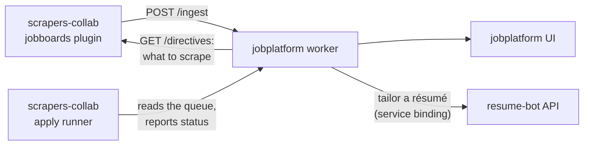

# Onboarding: the job-search pipeline

The job-search pipeline is three repos, and **you can work on any one of them
without the other two**. Each one runs and tests against the live versions of
the others, so you never clone, install or run a repo you aren't changing. Pick
your track below. Each track section is complete on its own.

Access steps that every hadoku repo shares live on
[hadoku.me/docs/contributing](https://hadoku.me/docs/contributing/). If that
page and this one disagree, that page is right. Tell the owner so this one gets
fixed.

## The three repos

| Repo                                                                       | Visibility | What it is                                                                              | Track                               |
| -------------------------------------------------------------------------- | ---------- | --------------------------------------------------------------------------------------- | ----------------------------------- |
| [hadoku-scrapers-collab](https://github.com/WolffM/hadoku-scrapers-collab) | private    | The job-board scrapers and the apply runner, as Python plugins for the scrape service   | [Scrapers](#track-scrapers)         |
| [hadoku-resume-bot](https://github.com/WolffM/hadoku-resume-bot)           | public     | The tailored résumé and cover-letter API, and the résumé page with its chat             | [Résumé](#track-résumé)             |
| [hadoku-jobplatform](https://github.com/WolffM/hadoku-jobplatform)         | public     | The feed, triage and application UI (React) and its API (Cloudflare Worker, TypeScript) | [Job platform](#track-job-platform) |



The arrows are the only places the repos touch. A change that keeps them intact
needs nothing from the other repos:

| Seam                                  | Defined in                                                                                            |
| ------------------------------------- | ----------------------------------------------------------------------------------------------------- |
| Scraper → jobplatform: jobs           | jobplatform `POST /ingest`; scrapers-collab `docs/jobboards-api.md`                                   |
| Jobplatform → scraper: what to scrape | jobplatform `GET /directives`                                                                         |
| Apply runner ↔ jobplatform: queue     | jobplatform `/applications*`, route table in its `AGENTS.md`                                          |
| Jobplatform → résumé: tailoring       | resume-bot `/tailored-resume`, `/cover-letter`, `/application-extras`, route table in its `AGENTS.md` |

## What you need, by track

| You need                     | Scrapers                                 | Résumé                           | Job platform                                        |
| ---------------------------- | ---------------------------------------- | -------------------------------- | --------------------------------------------------- |
| GitHub                       | invite to the private repo, write access | write access                     | write access                                        |
| A hadoku.me account (friend) | no                                       | only to try the tailoring routes | to sign in to the dev server                        |
| A service grant              | none                                     | none                             | `jobplatform-service-key`, for `pnpm test:e2e` only |
| Tools                        | git, Python 3.11+                        | git, Node 22+, pnpm 11           | git, Node 22+, pnpm 11                              |

`corepack enable` sets pnpm up. No track needs a `.npmrc`, a token or a
`.env` file to install, build or run its checks: every package comes from PyPI
or npmjs.

---

## Track: Scrapers

`hadoku-scrapers-collab` holds two plugins that run inside the private scrape
service: `jobboards` (Greenhouse, Lever, Ashby and LinkedIn listings, plus
matching a company to its board) and `apply` (the form runner). They are built on
the public [`hadoku-scrape-sdk`](https://pypi.org/project/hadoku-scrape-sdk/), so
you never need the service itself.

**Ask the owner for:** a GitHub invite to the repo. Accept it from your GitHub
notifications or email within 7 days, or it expires.

```sh
git clone git@github.com:WolffM/hadoku-scrapers-collab.git
cd hadoku-scrapers-collab
python -m venv .venv
.venv/bin/pip install -e '.[dev]'
.venv/bin/python -m patchright install --only-shell chromium
HADOKU_PLUGINS_MANIFEST=tests/resources/plugins.toml .venv/bin/python -m hadoku_sdk.plugins
# -> apply loaded, jobboards loaded
```

On Windows, `.venv/bin/` is `.venv\Scripts\`, and you set the variable with
`$env:HADOKU_PLUGINS_MANIFEST="tests/resources/plugins.toml"` (PowerShell) on a
line of its own.

**Checks** (CI runs the same; all must pass with zero warnings):

```sh
.venv/bin/python -m pytest tests/unit/ -q
.venv/bin/python -m ruff check .
```

The unit tests mock every network call. `tests/integration/` hits real job
boards, and its LinkedIn tests need a login.

**Read next:** the repo's `AGENTS.md` has the plugin contract, how to put a
scraper on the nightly schedule, and the rules the service enforces (events,
timestamps, browsers, secrets).

**Shipping:** push to `main`. Within about ten minutes the scrape service pulls
the commit, installs it and restarts. Deploys wait out the nightly hold
(23:00–08:00 Pacific) and any run in progress. Everything on `main` runs in
production with its secrets, so run the checks first.

---

## Track: Résumé

`hadoku-resume-bot` is one package with two halves: the résumé page and chat
widget (React, `src/`) and the worker API that assembles tailored résumés and
cover letters (`worker/src/`). The résumé itself is content blocks in a
Cloudflare KV store, not files in the repo. An LLM picks and lightly rewrites
blocks for a job, and a deterministic assembler builds the document.

**Ask the owner for:** write access to the repo, and a hadoku.me account at
friend tier if you'll work on tailoring.

```sh
git clone https://github.com/WolffM/hadoku-resume-bot.git
cd hadoku-resume-bot
pnpm install
pnpm dev          # http://localhost:5173
```

The dev page mounts the widget against the live API at
`hadoku.me/resume/api`, so it shows the real résumé. Add `?theme=ocean` to try a
theme, or `?apiBaseUrl=` to point it somewhere else.

**Checks** (there is no test suite in this repo):

```sh
pnpm typecheck
pnpm lint
pnpm format:check
pnpm lint:css
pnpm build
```

**The worker doesn't run locally.** It runs only inside hadoku.me, so a worker
change goes live when it deploys. Try the live routes with your own key. The
friend-only ones (tailoring, cover letters, `/system-prompt`) take it in a
header:

```sh
curl -H "X-User-Key: <your hadoku.me key>" https://hadoku.me/resume/api/system-prompt
```

A tailoring call spends a real LLM request. Its endpoints and request bodies are
in the repo's `AGENTS.md`.

**Read next:** `AGENTS.md` (endpoints and bindings) and
`docs/guide/contributing.md` (architecture: blocks, the assembler, the LLM
provider chain).

**Shipping:** push to `main`. CI publishes the package and hadoku.me redeploys
within minutes. CI sets the version, so never edit one by hand.

---

## Track: Job platform

`hadoku-jobplatform` is the dashboard at
[hadoku.me/jobplatform](https://hadoku.me/jobplatform/): the scored feed,
triage, the application pipeline, and the worker API behind them. It also holds
the Fill browser extension (`extension/`).

**Ask the owner for:** write access to the repo, a hadoku.me account at friend
tier, and, only if you'll run the signed-in browser tests, a service grant for
`jobplatform-service-key`.

```sh
git clone https://github.com/WolffM/hadoku-jobplatform.git
cd hadoku-jobplatform
pnpm install
pnpm exec playwright install chromium   # once, for the browser tests
pnpm dev                                # http://localhost:5173
```

The dev server talks to the **real production API**. To sign in, open
`http://localhost:5173/?apiKey=<your hadoku.me key>` once. It swaps the key for
a session cookie the way production does. After that, plain `localhost:5173`
keeps you signed in.

**Checks** (CI runs the same; none needs a credential):

```sh
pnpm lint
pnpm lint:css
pnpm typecheck
pnpm test:unit
pnpm test:extension
pnpm build
cd worker && pnpm test
```

`pnpm test:e2e` runs the browser suite against the real API, signed in as the
shared e2e test account. It is the one command that needs the service grant:
see [Your credential](#your-credential-only-for-pnpm-teste2e).

**Read next:** `AGENTS.md` (the full route table and the decisions behind the
feed) and [`docs/guide/contributing.md`](guide/contributing.md) (the
architecture map).

**Shipping:** push to `main`. CI publishes both packages and hadoku.me
redeploys within minutes. CI sets the versions, so never edit one by hand.

### Your credential (only for `pnpm test:e2e`)

There are no shared keys. You hold your own credential, it lasts 7 days, and you
renew it with your passkey and an authenticator app.

1. Sign in at [hadoku.me](https://hadoku.me), in the browser you'll approve from.
2. In the clone, run `npx @hadoku/dev-vault login`. It prints a code and a link to
   hadoku.me/account/device. Leave it running: it waits up to 24 hours.
3. Open the link. It shows which machine and repo are asking. **The first time only:**
   - save a passkey (Windows Hello, Touch ID or your phone) if you have none;
   - set up your authenticator: tap the passkey, scan the QR code with an
     authenticator app, then type its 6-digit code.
4. **Every time:** check the identity (it picks the repo's for you), type the app's
   current code, press **Approve** and tap your passkey.
5. The terminal says it wrote `.devvault.local.json` in your clone. That file is
   gitignored. Never commit it or share it.
6. Check it with `npx @hadoku/dev-vault --check`.

Renew with `npx @hadoku/dev-vault login` every 7 days, or whenever the tests
answer 401 or `required: friend`. After the first time it's just the approve
screen.

---

## Rules for every track

- **Read the repo's `AGENTS.md` before your first change.** It holds the rules each
  change must keep, and why.
- **You push straight to `main`, and that ships to production.** No pull request is
  needed, and nothing reviews the change before it goes live. Run the repo's
  checks first, and push only when they all pass.
- **Dev talks to production.** In the résumé and job-platform tracks, what you
  save from the dev server is saved for your real account.
- **Never press "Queue for Auto-Apply"** in dev or in a test. It queues a real
  application, which the apply runner fills in and can send to a real employer. A
  browser test must block the route: `page.route('**/jobs/*/apply', r => r.abort())`.
- **Colours come from theme tokens** (`var(--color-*)`), never hex values or
  fallbacks. `pnpm lint:css` checks this in both JS repos.
- **No `.env` files.** Secrets arrive in production as the service's environment;
  ask the owner before code reads a new one.
- **To see what happened in production,** jobplatform's `AGENTS.md`, section
  "Telemetry", has the commands and every event name.

## If something goes wrong

| What you see                                     | What to do                                                                                                                        |
| ------------------------------------------------ | --------------------------------------------------------------------------------------------------------------------------------- |
| `git clone` of scrapers-collab says not found    | The GitHub invite isn't accepted yet, or it expired. Ask the owner for a new one.                                                 |
| `pnpm install` fails with 401 on `@wolffm/*`     | A dependency slipped back to GitHub Packages. That's a bug: tell the owner. Every `@wolffm/*` should be an `npm:@hadoku/*` alias. |
| Browser tests say "Executable doesn't exist"     | Run `pnpm exec playwright install chromium` (job platform) or the `patchright install` line (scrapers).                           |
| Port 5173 is taken                               | Both JS repos use it. Stop the other dev server, or run `pnpm dev --port 5174`.                                                   |
| "You hold no service grants" on the approve page | The grant for that identity is missing. Ask the owner.                                                                            |
| The passkey prompt has nothing to pick           | Your passkey is on another device. Choose **Use another device** and scan with that phone, or save one here.                      |
| The login request expired                        | Run `npx @hadoku/dev-vault login` again.                                                                                          |
| 401 or `required: friend`                        | Your 7-day credential expired, or your hadoku.me key isn't friend tier. Log in again, or ask the owner.                           |
| "Cloudflare refused this network"                | This shouldn't happen from any network. Tell the owner.                                                                           |
