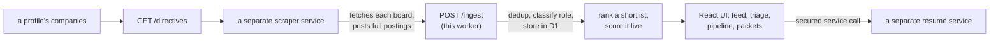

# Job Platform: contributing

How to run, change and ship Job Platform. What it does for a user is in
[features.md](features.md). The full route table, data model and open
questions live in this repo's own [`AGENTS.md`](../../AGENTS.md) and
[`ARCHITECTURE.md`](../../ARCHITECTURE.md) — read those before touching the
scorer, the ingest pipeline or role classification.

## Run it

New here? [`docs/ONBOARDING.md`](../ONBOARDING.md) is the first-day checklist:
access and setup for this repo, or for either of the two it works with on its own.

Needs Node 22+ and pnpm. Installing and every check need no credential or
`.npmrc`: the `@wolffm/*` dev dependencies are npm aliases of their public
copies.

```sh
pnpm install
pnpm dev          # dev server on :5173
pnpm build        # build both packages
pnpm lint         # eslint
pnpm lint:css     # stylelint + theme-token check
pnpm typecheck

cd worker && pnpm test   # node:test, no framework
```

The dev server talks to the real production API and needs no credential of
its own. The signed-in end-to-end suite does (a `jobplatform-service-key`
grant, because it signs in as the shared e2e account); getting one is documented
in this repo's own README. To act as an authenticated user in dev, pass
`?apiKey=<your hadoku.me key>` once — the harness in
`index.html` exchanges it for a session id through the same code path
production uses. The parameter is dev-only and never accepted in
production.

Logging goes through the logger from `@wolffm/task-ui-components`, not
`console.log`:

```typescript
import { logger } from '@wolffm/task-ui-components'
logger.info('Message', { key: 'value' })
```

## Architecture

Two independently published packages live in one repo:

| Package                      | Path      | What it is                              |
| ---------------------------- | --------- | --------------------------------------- |
| `@wolffm/jobplatform`        | `src/`    | React micro-frontend, `mount`/`unmount` |
| `@wolffm/jobplatform-worker` | `worker/` | Cloudflare Worker API (Hono + D1)       |



Companies are a **directive the scraper pulls**, never a target this app
pushes: the worker publishes what it wants scraped at `GET /directives`, and
the scraper reads that on its next run (`worker/src/routes/ingest.ts`). That
keeps registry ownership in one place — the scraper decides how to scrape,
this app decides what is worth scraping.

**Companies are not a feed filter.** Adding a company to a profile only puts
its board's jobs into the corpus. From there every job competes on the
profile's criteria alone, wherever it came from. Until 2026-09-10 a profile's
companies were a hard filter, so subscribing to three companies hid about
33,000 of 34,135 jobs.

**Ranking** happens in two passes (`worker/src/routes/jobs/feed.ts`). The
light pass scores every job without reading its description: title,
location, workplace type, salary and level. That number is precomputed per
profile into the `job_profile_rank` table (`worker/src/rank.ts`), so the feed
can sort and cap in SQL instead of reading the whole corpus. The top 800 then
get the full score, descriptions included, live on every request. So the
score a user sees always reflects their profile as it is now.

The stored ranking is built lazily. The first feed request that finds none is
ranked live and builds one behind its response, and a profile edit rebuilds it
the same way. Two markers in `job_profile_rank_state` (a hash of the
profile's criteria, and the newest job covered) decide whether it can be
trusted. When it cannot, the feed ranks live. Stale rank data therefore costs
speed, never correctness. A change to the scorer itself is not covered by the
hash: rebuild with `POST /ingest/rebuild-rank`.

**The score** (`worker/src/scoring.ts`) is a weighted sum of six axes:

| Axis              | Weight | What it measures                                                        |
| ----------------- | -----: | ----------------------------------------------------------------------- |
| `relevance`       |   0.40 | profile keywords in the title and description, with diminishing returns |
| `level_match`     |   0.15 | distance on the seniority ladder                                        |
| `domain_interest` |   0.15 | the profile's liked and avoided topics                                  |
| `geo_fit`         |   0.12 | remote / hybrid / onsite preference, and the posting's country          |
| `comp_fit`        |   0.10 | published salary against the profile's floor                            |
| `stack_fit`       |   0.08 | technologies named in the title that the profile's stack lacks          |

`level_match` grades by distance, not equality: exact rung 1.0, one rung off
0.7, further or off-track 0.2. An unclassified job scores 0.5, since no
signal is not the same as a bad match. An unpublished salary is neutral for
the same reason: most strong payers do not publish one.

Some evidence multiplies the whole score instead of adding to it: a job in an
adjacent discipline (×0.15), a posting that names only regions outside the
profile's home region (×0.1), and a published salary far below the floor
(×0.15). The home region (Americas, EMEA or APAC) comes from the profile's
`location`, and is the Americas when none is set. The discipline factor is
waived when one of the profile's keywords is itself an adjacent-ladder title
("project manager") and the posting's title carries it. The feed then applies the
caller's own factors live: their up or down vote, how stale the posting is,
how long ago it was posted, and how many applications they already have out
at that company (×0.85 from one, ×0.6 from five, ×0.3 from twenty). Those
stay out of the stored ranking because they are per person and change on
every click.

**Filters** are separate from the score, because "only show me X" is a
different request from "rank X higher". The profile's IC or manager track is
a hard SQL filter. The feed's salary floor, location radius and blocked
companies are view filters. A posting with no listed salary survives the
salary filter rather than being hidden, since most postings list none. Full
algorithm and data model: [`ARCHITECTURE.md`](../../ARCHITECTURE.md).

**Role classification** (`worker/src/roleClassify.ts`) infers a job's
seniority and track, since no ATS publishes either. It uses two separate
axes rather than one flat list. `track` is `ic` or `manager`: does the job
have direct reports? `level` is the rung on that track's ladder. They are
separate because `senior` and `manager` answer different questions; they
are not alternatives. It reads the title's head, before the first comma, so
"Software Engineer, Ads Manager" lands as an IC. Only the ambiguous `lead`
family falls back to reading the description. Regression cases live in
`worker/tests/roleClassify.test.ts`.

**Gating** is tier-ranked (`public < friend < service < admin`) and enforced
in-worker, never just upstream: `worker/src/routes/jobs/shared.ts`'s
`gateAuthed` covers most `/jobs/*` routes (triage, pipeline, tailoring,
applications, skills, fill); `worker/src/routes/profiles.ts` and
`worker/src/routes/companies.ts` gate their own trees the same way. A caller
can act **on another person's behalf** only by name, and only when it is
admin or a short list of named service callers checked against the key
registry — never trusted from the request alone
(`worker/src/routes/jobs/shared.ts`, `effectiveUserId`). The parent site's
edge router resolves a session cookie into a user key and stamps the tier
on the request; the worker trusts that stamp only when its provenance
header verifies, so a request that bypasses the edge degrades to `public`
rather than being trusted.

**The Fill extension** (`extension/`) is a separate Chrome MV3 build, zipped
into the dashboard's own bundle (`pnpm build` builds it first) and served as
a download from the Applications view. It shares `src/components/matchOption.ts`
with the dashboard but otherwise ships independently; test it with
`pnpm test:extension`.

## Tests and gates

```sh
pnpm lint
pnpm lint:css
pnpm typecheck
pnpm test:extension
pnpm test:unit           # browser units in Chromium
cd worker && pnpm test
```

CI's `test` job runs the worker suite and the browser units and posts both,
red runs too, to the fleet test store through
`WolffM/hadoku-actions/report-tests` (suites `worker` and `browser-units`,
from `worker/reports/node-test.xml` and `reports/unit.json`; advisory, it
never fails the job).

Colors come from `@wolffm/themes` as semantic CSS custom properties; never a
hex literal or a `var(--x, fallback)`. `pnpm lint:css` fails the build on a
reference to a token the theme does not define, since an undefined token
otherwise renders as nothing.

## How it deploys

Push to `main` runs `.github/workflows/publish.yml`, which builds and
publishes both packages to GitHub Packages (and mirrors them to npmjs as
`@hadoku/*`), then dispatches a `packages_updated` event that tells the
platform's site repo to pull the new versions and redeploy. **Versions are
CI's, never a commit's**: the publish workflow sets each package to the
registry's newest version plus one patch; nobody edits a version by hand.

## Trivia

A dependency's newly tightened lint rule once blocked every `@wolffm/*`
auto-update for about 19 hours with no alert — eleven failed CI runs in a
row, each for the same pre-existing CSS violation the rule had not caught
before. The fix was one commit once somebody noticed: three colour tokens
used as bare text instead of a tinted background (`6b698d7`;
[the incident note of 2026-08-04](../incident-2026-08-04-ci-failures.md)).
