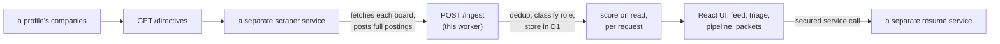

# Job Platform: contributing

How to run, change and ship Job Platform. What it does for a user is in
[features.md](features.md). The full route table, data model and open
questions live in this repo's own [`AGENTS.md`](../../AGENTS.md) and
[`ARCHITECTURE.md`](../../ARCHITECTURE.md) — read those before touching the
scorer, the ingest pipeline or role classification.

## Run it

Needs Node 22+ and pnpm. Installing and every check need no credential or
`.npmrc`: the `@wolffm/*` dev dependencies are npm aliases of their public
copies.

```sh
pnpm install
pnpm dev          # dev server on :5173
pnpm build        # build both packages
pnpm lint         # eslint
pnpm lint:css     # stylelint + theme-token check
pnpm typecheck

cd worker && pnpm test   # node:test, no framework
```

The dev server and the signed-in end-to-end suite talk to the real
production API, so those need your own credential (a `jobplatform-service-key`
grant); getting one is documented in this repo's own README. To act as an
authenticated user in dev, pass `?apiKey=<key>` once — the harness in
`index.html` exchanges it for a session id through the same code path
production uses. The parameter is dev-only and never accepted in
production.

Logging goes through the logger from `@wolffm/task-ui-components`, not
`console.log`:

```typescript
import { logger } from '@wolffm/task-ui-components'
logger.info('Message', { key: 'value' })
```

## Architecture

Two independently published packages live in one repo:

| Package                      | Path      | What it is                              |
| ---------------------------- | --------- | --------------------------------------- |
| `@wolffm/jobplatform`        | `src/`    | React micro-frontend, `mount`/`unmount` |
| `@wolffm/jobplatform-worker` | `worker/` | Cloudflare Worker API (Hono + D1)       |



Companies are a **directive the scraper pulls**, never a target this app
pushes: the worker publishes what it wants scraped at `GET /directives`, and
the scraper reads that on its next run (`worker/src/routes/ingest.ts`). That
keeps registry ownership in one place — the scraper decides how to scrape,
this app decides what is worth scraping.

**Scoring** runs on read, per request (`worker/src/routes/jobs/feed.ts`), not
from a precomputed table — a score always reflects the profile as it is
right now. Three things are hard SQL filters rather than score factors,
because "only show me X" is a different request from "rank X higher": a
profile's companies, its IC/manager track, and (as a view control) the
feed's salary floor. Salary itself was removed as a score factor entirely —
`salary_min` is NULL on most postings, so scoring it returned a neutral ~0.5
for nearly everything, noise dressed as signal — and demoted to that view
filter; a posting with no listed salary still survives it rather than being
hidden. The four remaining signals and their weights:

| Signal          | Weight | What it measures                            |
| --------------- | -----: | ------------------------------------------- |
| `keyword_match` |   0.40 | profile keywords against the description    |
| `title_match`   |   0.30 | profile keywords against the title          |
| `level_match`   |   0.15 | distance on the seniority ladder            |
| `remote_match`  |   0.15 | remote / hybrid / onsite against preference |

`level_match` grades by distance, not equality: exact rung 1.0, one rung off
0.7, further or off-track 0.2 — and an unclassified job scores 0.5, since no
signal is not the same as a bad match. Full algorithm and data model:
[`ARCHITECTURE.md`](../../ARCHITECTURE.md).

**Role classification** (`worker/src/roleClassify.ts`) infers seniority and
track from the title's head, since no ATS publishes either, along two
orthogonal axes — `track` (`ic` or `manager`: does the job have direct
reports?) and `level` (the rung on that track's ladder) — rather than one
flat list, because `senior` and `manager` are answers to different
questions, not alternatives. It reads the title's head, before the first
comma, so "Software Engineer, Ads Manager" correctly lands as an IC; only
the genuinely ambiguous `lead` family falls back to probing the description
body. Regression cases live in `worker/tests/roleClassify.test.ts`.

**Gating** is tier-ranked (`public < friend < service < admin`) and enforced
in-worker, never just upstream: `worker/src/routes/jobs/shared.ts`'s
`gateAuthed` covers most `/jobs/*` routes (triage, pipeline, tailoring,
applications, skills, fill); `worker/src/routes/profiles.ts` and
`worker/src/routes/companies.ts` gate their own trees the same way. A caller
can act **on another person's behalf** only by name, and only when it is
admin or a short list of named service callers checked against the key
registry — never trusted from the request alone
(`worker/src/routes/jobs/shared.ts`, `effectiveUserId`). The parent site's
edge router resolves a session cookie into a user key and stamps the tier
on the request; the worker trusts that stamp only when its provenance
header verifies, so a request that bypasses the edge degrades to `public`
rather than being trusted.

**The Fill extension** (`extension/`) is a separate Chrome MV3 build, zipped
into the dashboard's own bundle (`pnpm build` builds it first) and served as
a download from the Applications view. It shares `src/components/matchOption.ts`
with the dashboard but otherwise ships independently; test it with
`pnpm test:extension`.

## Tests and gates

```sh
pnpm lint
pnpm lint:css
pnpm typecheck
pnpm test:extension
cd worker && pnpm test
```

Colors come from `@wolffm/themes` as semantic CSS custom properties; never a
hex literal or a `var(--x, fallback)`. `pnpm lint:css` fails the build on a
reference to a token the theme does not define, since an undefined token
otherwise renders as nothing.

## How it deploys

Push to `main` runs `.github/workflows/publish.yml`, which builds and
publishes both packages to GitHub Packages (and mirrors them to npmjs as
`@hadoku/*`), then dispatches a `packages_updated` event that tells the
platform's site repo to pull the new versions and redeploy. **Versions are
CI's, never a commit's**: the publish workflow sets each package to the
registry's newest version plus one patch; nobody edits a version by hand.

## Trivia

A dependency's newly tightened lint rule once blocked every `@wolffm/*`
auto-update for about 19 hours with no alert — eleven failed CI runs in a
row, each for the same pre-existing CSS violation the rule had not caught
before. The fix was one commit once somebody noticed: three colour tokens
used as bare text instead of a tinted background (`6b698d7`;
[the incident note of 2026-08-04](../incident-2026-08-04-ci-failures.md)).
