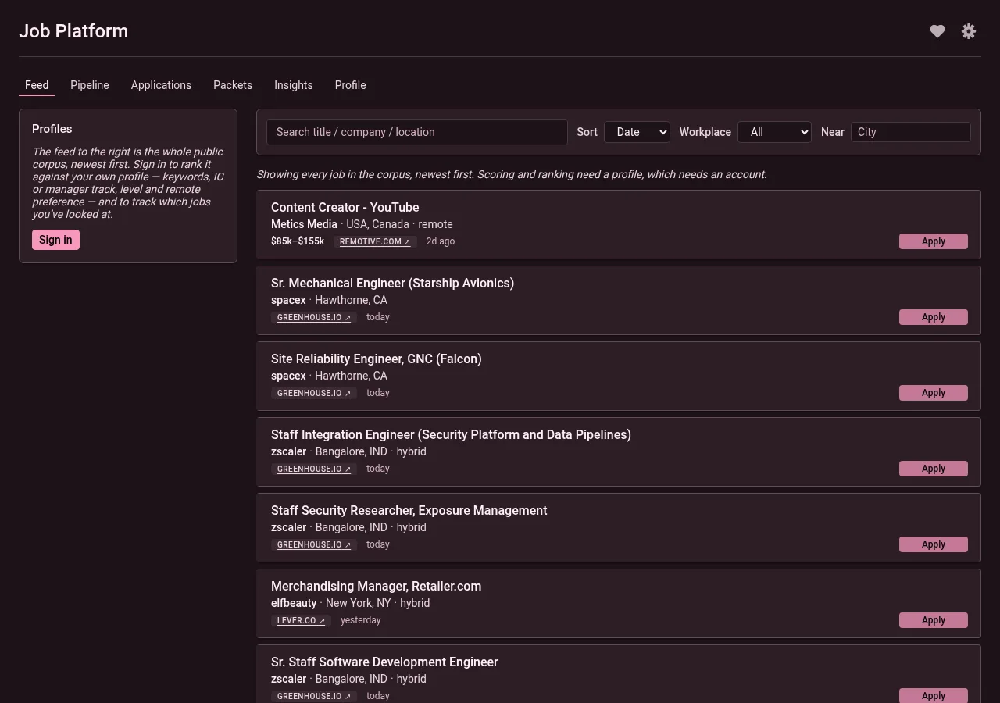

# Job Platform

Job boards rank by recency, not by fit, so finding the handful of postings
that changed means re-reading the same couple hundred every week. Job Platform
inverts that: describe the role you want once, as a **profile**, and every
scrape run re-ranks the whole corpus against it. From there you triage what
survives, track what you apply to, and generate the paperwork for each one —
résumé, cover letter, screening answers — as a single packet.

It lives at [hadoku.me/jobplatform](https://hadoku.me/jobplatform). The feed
is public: anyone can browse scored postings with no account. Profiles,
triage state, the pipeline and application packets need to be signed in at
friend tier or above.

## How a posting gets here

A separate scraper service enumerates company application boards (Greenhouse,
Lever, Ashby) for the companies named across every profile, and posts batches
of full postings to this app's own `/ingest` endpoint. From there Job
Platform owns everything: deduplication, scoring, the UI, triage and the
application packet. The scraper owns only how to fetch a board; this app
decides what is worth fetching and ranks what comes back. See
[contributing.md](contributing.md#architecture) for the pipeline end to end.

## Where to read next

| You want to                      | Read                               |
| -------------------------------- | ---------------------------------- |
| use it                           | [features.md](features.md)         |
| run it, change it, or deploy it  | [contributing.md](contributing.md) |
| how it got from scaffold to here | [history.md](history.md)           |
| the odd facts                    | [trivia.md](trivia.md)             |

The full worker API table and the design decisions behind scoring, roles and
geography live in this repo's own [`AGENTS.md`](../../AGENTS.md) and
[`ARCHITECTURE.md`](../../ARCHITECTURE.md) — read those before changing the
scorer or the ingest pipeline.

## Trivia

The full list, each with its source, is in [trivia.md](trivia.md).
